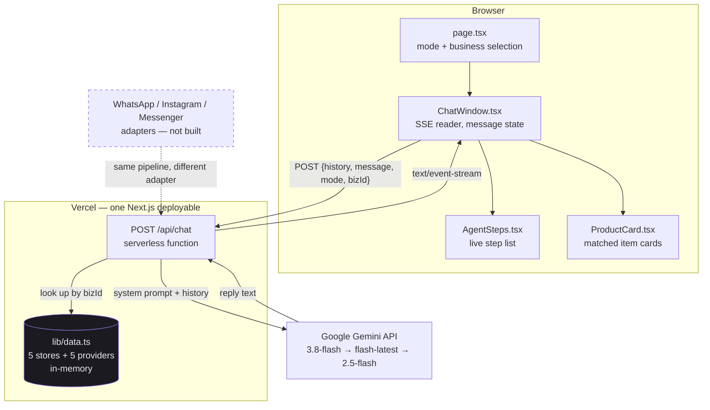
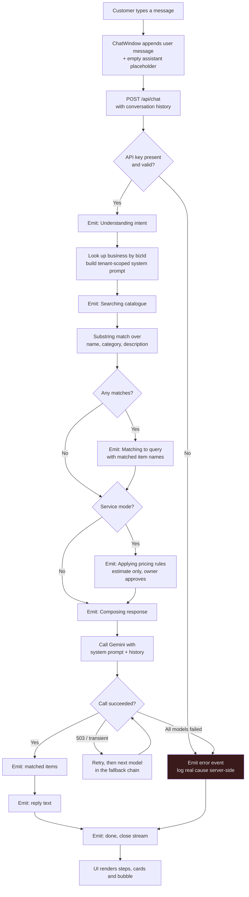
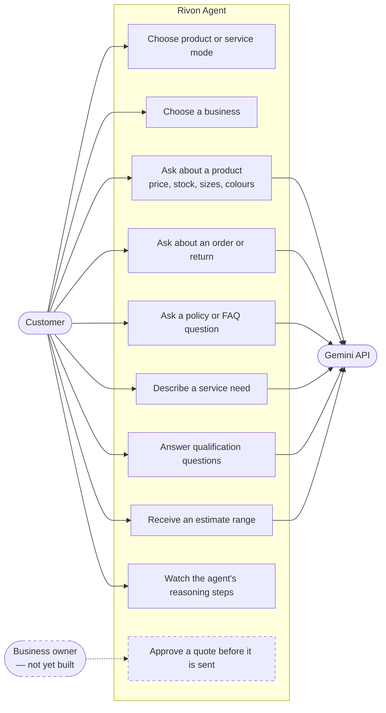

# Rivon Agentic Layer — Implementation Notes

**Repo:** https://github.com/syedd176/rivon-agent
**Live:** https://rivon-agent.vercel.app
**Written:** 13 October 2026

This document explains what was built, why it was built this way, and how the
pieces fit together. It is written for someone joining the project who has not
seen the code.

---

## 1. What this is, and what it is not

Rivon's product plan is an AI agent that answers a business's customers on
WhatsApp, Instagram and Facebook Messenger. Those channels need a Meta app that
has passed Business Verification and App Review — a process measured in weeks,
and currently blocked (see `CONTEXT.md` §4 in the main `rivon` repo).

So the agent had no way to be tested.

**This project removes that dependency.** It is a web UI that exercises the
identical inbound path a real channel would: a message arrives, the agent
classifies it, searches a catalogue, applies pricing rules, and replies. Only
the adapter differs. When the Meta app clears review, a WhatsApp adapter can
feed the same pipeline without the agent logic changing.

It is also a demo. The whole agent process is rendered on screen, step by step,
so a non-technical person can see what the agent is doing rather than watching
a spinner.

**What it is not:** there is no database, no authentication, no persistence, and
no multi-tenancy. Conversations live in React state and die on refresh.
Catalogues are TypeScript constants. That is deliberate — see §7.

---

## 2. The two modes

The UI splits at the first screen, because the two cases behave differently.

### Product mode — five ecommerce storefronts

| Store | Sells | Items |
|---|---|---|
| SoundDrop | Earbuds, headphones, handsfree, accessories | 8 |
| ThreadHouse | Men's and women's t-shirts, oversized, polos | 7 |
| SoleStride | Casual shoes, running, formal, slides | 7 |
| Fabric & Fold | Unstitched fabric — lawn, linen, silk, winter, embroidered | 6 |
| PetPaw | Dog and cat food, toys, accessories, grooming | 8 |

Each store carries its own catalogue, return policy, shipping policy, and FAQ
list. A customer asks about availability, stock, sizing, colours, an order, a
return, or a policy, and the agent answers from that store's data only.

Why five, and why different trades? Because one catalogue proves nothing. The
same agent code has to work for a store where *size* is the key attribute
(clothing), one where *stock and lead time* matter (electronics), and one where
the unit itself is unusual (fabric sold by the metre, in sets). If the prompt
only worked for earbuds, that would be a prompt tuned to one dataset.

### Service mode — five providers

| Provider | Trade |
|---|---|
| ClearSpace | Pest control |
| SparkFit EV | EV charger installation |
| BrightHome | Cleaning |
| SwiftMove | Removals |
| SolarStep | Solar panels and battery storage |

Services are a different problem. A customer cannot be sold a service from a
catalogue line, because the price depends on facts the business does not have
yet — postcode, property size, what pest, how long. So each provider carries
**qualification questions**, and the agent asks them before discussing money.

### The rule that separates them

> The model never produces a number that commits the business.

In product mode, prices come from the catalogue and the agent is told never to
invent one. In service mode, the agent gives **estimate ranges only** and states
that the owner approves the final price.

This is not stylistic caution. A quoted price can bind the business: *Moffatt v
Air Canada* (2024) rejected the defence that a chatbot is a separate agent from
the company operating it. The constraint is inherited from the main project's
design and is enforced in the system prompt on every single request, not just
the first turn of a conversation.

---

## 3. Infrastructure

| Layer | Choice | Why |
|---|---|---|
| Framework | Next.js 16 (App Router, Turbopack) | One deployable holds both the UI and the API. No separate backend to host. |
| Language | TypeScript | The catalogue shapes are the contract between the API and the UI; the compiler enforces them. |
| Styling | Tailwind 4 + CSS custom properties | Tokens in `globals.css`, so the palette is defined once. |
| LLM | Google Gemini (`gemini-3.8-flash`) | Fast and cheap for short conversational replies. Falls back to two other models. |
| Hosting | Vercel | Native Next.js target; the API route deploys as a serverless function with no config. |
| Icons | lucide-react | — |

**There is no database.** Catalogues are a TypeScript module. §7 explains why
that was the right call for this stage and what replaces it later.

**Secrets.** `GEMINI_API_KEY` is a server-side Vercel environment variable. It
is read only inside the API route, never prefixed `NEXT_PUBLIC_`, and never
reaches the browser. `.env.local` is gitignored; no key is committed.

---

## 4. How the backend works

The whole backend is one file: `app/api/chat/route.ts`. It is a single
`POST` handler, and it does four things.

### 4.1 Build the prompt per business

The request carries `mode` (`product` or `service`) and `bizId`. The handler
looks up that business and serialises **only that business's** catalogue, FAQ
and policies into the system prompt.

This is the multi-tenant boundary, done the cheap way. SoundDrop's agent cannot
see ThreadHouse's catalogue, because ThreadHouse's data was never put in the
prompt. When this moves to a database, the same boundary becomes a tenant-scoped
query — the structure does not change, only where the rows come from.

### 4.2 Retrieve matching items

`findProductMatches` / `findServiceMatches` do a substring and word match over
name, category and description, capped at three results. These matched items are
sent to the UI as cards *and* are what the "searching catalogue" step reports.

This is deliberately simple — not embeddings, not a vector store. At eight items
per business, substring matching is correct and instant. The function is the
seam where retrieval gets upgraded later without touching anything else.

### 4.3 Stream the agent's steps

The response is **Server-Sent Events**, not JSON. The handler opens a
`ReadableStream` and emits events as the work happens:

```
data: {"type":"step","stepType":"thinking","id":"1","label":"Understanding intent","status":"running"}
data: {"type":"step","stepType":"thinking","id":"1","label":"Understanding intent","status":"done"}
data: {"type":"step","stepType":"searching","id":"2","label":"Searching catalogue","detail":"8 items","status":"running"}
...
data: {"type":"matched","items":[ ... ]}
data: {"type":"content","text":"We have two earbud options..."}
data: {"type":"done"}
```

Each step is sent twice — once `running`, once `done` — and the UI replaces the
step in place by its `id`. That is what makes the checkmarks resolve one by one
instead of all appearing at the end.

The event envelope has a `type` (`step`, `matched`, `content`, `error`, `done`)
and a step additionally has a `stepType` (`thinking`, `searching`, `matching`,
`pricing`, `responding`). **These are two different fields on purpose**, and
conflating them was one of the two bugs described in §6.

### 4.4 Call Gemini, with fallback

Flash models return `503` under load. A single failed call would look to the
customer like the agent is broken. So `generateWithFallback` tries three models
in order, with one retry each:

```
gemini-3.8-flash → gemini-flash-latest → gemini-2.5-flash
```

A `404` (model retired) breaks out of the retry loop immediately and moves to
the next model, because retrying a model that no longer exists is pointless.

If everything fails, the customer sees plain language — "the AI service is busy,
send that again" — while the real error goes to `console.error` and lands in
Vercel's runtime logs. §6 shows why that logging mattered.

---

## 5. Diagrams

### 5.1 System architecture



The dashed box is the point of the whole exercise: the channel adapters are the
only missing piece, and they attach at one place.

### 5.2 Activity diagram — one message, end to end



### 5.3 Use case diagram



The owner approval path is drawn because it is the design's central rule, but
it is **not implemented** — the agent currently states that the owner approves,
without an owner-facing surface existing yet. That is the most important gap in
the system (§7).

### 5.4 Event sequence


---

## 6. Two bugs worth knowing about

Both of these cost real time, and both were invisible from the browser. The
symptom in each case was identical: agent steps appeared and completed, then
nothing — no reply, no error.

### 6.1 The model had been retired

`gemini-2.0-flash` no longer exists. Google's API returns a `404` whose body
names the replacement:

```
This model models/gemini-2.0-flash is no longer available.
Please update your code to use models/gemini-3.8-flash
```

Nothing in the browser showed this, because the failure was caught and replaced
with a generic message before it reached the client.

**Lesson:** read the upstream error body. It contained the exact fix.

### 6.2 The API key carried an invisible BOM

This one is worth describing fully, because it would be very hard to find twice.

After fixing the model name, the chat worked locally but failed on every single
request in production. Same code, same key. The client showed only the generic
failure message.

The cause was in how the key had been uploaded:

```powershell
echo "AIza..." | npx vercel env add GEMINI_API_KEY production
```

PowerShell's `echo` writes UTF-8 **with a byte order mark**. So the stored value
was `AIza...` rather than `AIza...`. The Gemini SDK puts the key into an
HTTP header, and `` (65279) cannot be encoded as a ByteString, so the
request threw before it ever left the server:

```
TypeError: Cannot convert argument to a ByteString because the character
at index 0 has a value of 65279 which is greater than 255
```

Finding it required `console.error` on the catch block and then reading
`vercel logs`. The generic customer-facing message was hiding the one string
that identified the problem.

**Fixes applied, both of them:**

1. The key was removed and re-added through bash's `printf`, which writes no BOM.
2. The code strips it anyway, so no future shell can reintroduce the fault:

```ts
const API_KEY = (process.env.GEMINI_API_KEY ?? "").replace(/^/, "").trim();
```

**Lesson:** when local works and production does not, with identical code, the
difference is in the environment — and environment values can be malformed in
ways no editor will show you. Always log the real error server-side, even when
showing the customer something softer.

### 6.3 A smaller one: two fields with the same name

The SSE envelope has a `type` (`step`, `content`, …) and each step has its own
kind. The client was reading `event.type` for both, so every step's kind came
back as the literal string `"step"` and no step icon ever resolved. Renaming the
inner field to `stepType` fixed it. Worth noting because it is the kind of bug
that looks like a styling problem and is not.

---

## 7. What is deliberately missing

Nothing here is an oversight. Each is a decision about sequencing.

| Gap | Why it is acceptable now | What it becomes |
|---|---|---|
| **No database** | Ten businesses, ~70 items total, all read-only. A database would add deploy surface and migration work for data that currently never changes. | Postgres or DynamoDB, tenant-scoped. The lookup in §4.1 becomes a query; nothing else moves. |
| **No conversation persistence** | State lives in React and dies on refresh. For a demo that is fine, and it keeps the data model out of the way. | Needed before any real channel, because WhatsApp conversations span days. |
| **No owner approval UI** | The agent *says* the owner approves. There is no owner surface. | The single most important gap. The design's central rule is currently enforced only by prompt. |
| **No channel adapters** | Blocked on Meta Business Verification and App Review. | A webhook per channel that normalises the inbound payload and calls the same pipeline. |
| **Naive retrieval** | Substring matching is exact and instant at this size. | Embeddings when catalogues reach hundreds of items. |
| **No auth, no rate limiting** | Public demo, no customer data, no writes. | Both are required before this handles real traffic. |

The honest summary: **the conversational layer is real and the surrounding
platform is not.** That is the right order for the problem — the conversation
was the part nobody had been able to test.

---

## 8. Running it

```bash
git clone https://github.com/syedd176/rivon-agent
cd rivon-agent
npm install

# Gemini key from Google AI Studio
echo "GEMINI_API_KEY=your_key_here" > .env.local

npm run dev     # http://localhost:3000
npm run build   # production build, includes type check
```

Deploying:

```bash
npx vercel --prod

# add the key — note printf, NOT PowerShell echo, per §6.2
printf 'your_key_here' | npx vercel env add GEMINI_API_KEY production
```

---

## 9. File map

```
app/
  page.tsx              Three screens: mode select → business select → chat
  layout.tsx            Fonts, metadata
  globals.css           Colour tokens, animations
  api/chat/route.ts     The entire backend — prompt, retrieval, SSE, fallback

components/
  ChatWindow.tsx        Message state, SSE reader, input, suggested questions
  AgentSteps.tsx        Renders the live step list with status icons
  ProductCard.tsx       Matched item cards, handles products and services

lib/
  data.ts               All catalogue data — 5 stores, 5 providers, FAQs, policies
```

Four files carry the real logic: `route.ts` is the backend, `ChatWindow.tsx` is
the client half of the streaming protocol, `data.ts` is the content, and
`page.tsx` is navigation. Everything else is presentation.

---

## 10. Suggested next steps

In the order that gets the most value per unit of work:

1. **Build the owner approval surface.** The pricing rule is the design's
   foundation and is currently enforced only by prompt. A queue of pending
   quotes with approve/edit/reject would make it real.
2. **Persist conversations.** Everything else that matters depends on this.
3. **Define the `requirements.extracted` payload.** `CONTEXT.md` §6 flags this
   as unassigned and both teams are guessing without it. This project now has a
   working agent that could produce a first draft of that shape from real
   conversations rather than from speculation.
4. **Add the web widget adapter.** Embeddable script, same pipeline. It needs no
   Meta approval and proves the adapter seam works before WhatsApp arrives.
