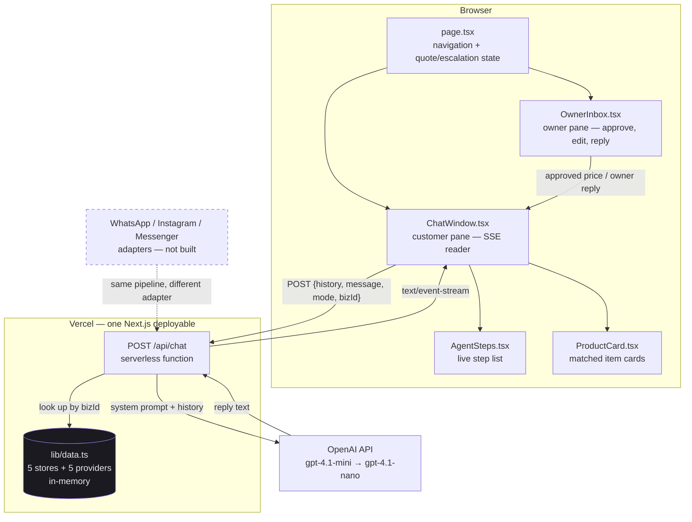
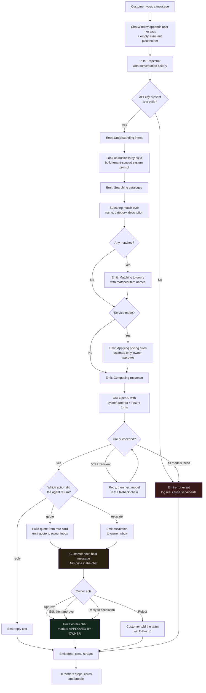
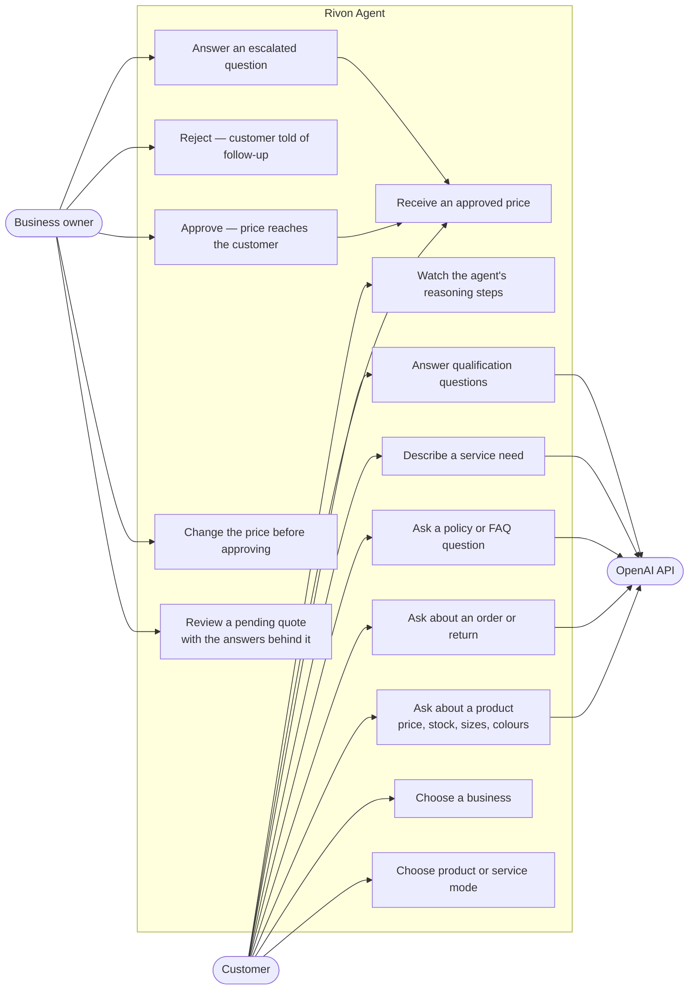
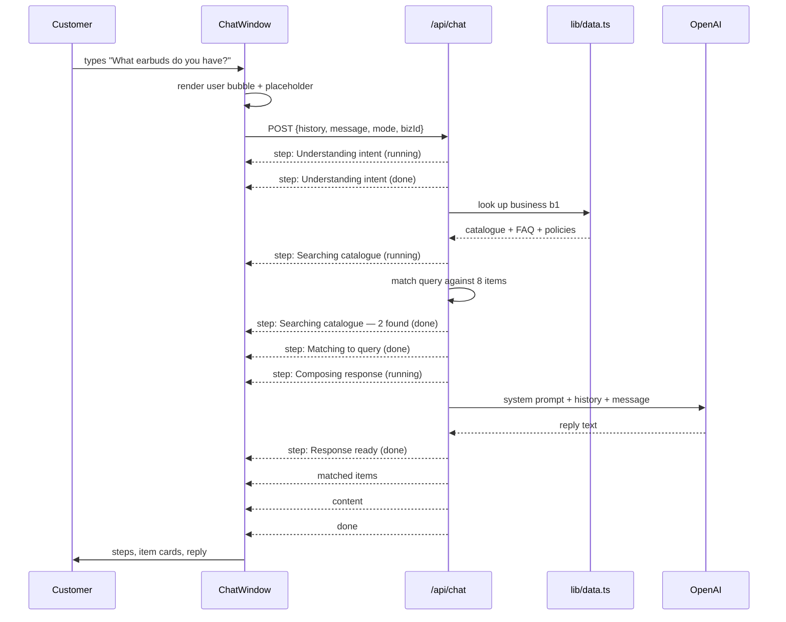
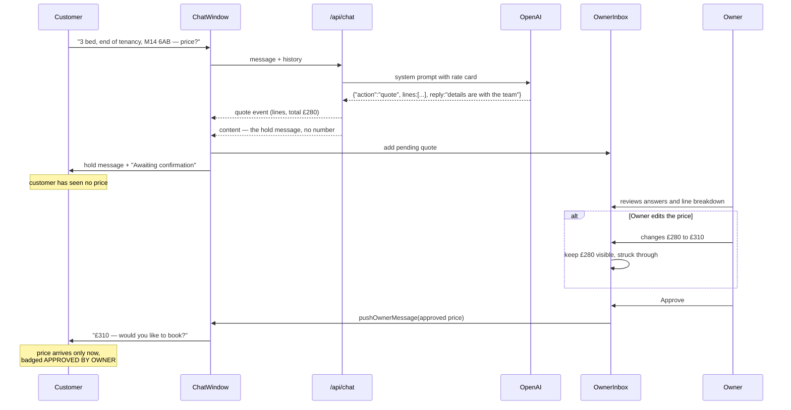

# Rivon Agentic Layer — Implementation Notes

**Repo:** https://github.com/syedd176/rivon-agent
**Live:** https://rivon-agent.vercel.app
**Written:** 13 October 2026

This document explains what was built, why it was built this way, and how the
pieces fit together. It is written for someone joining the project who has not
seen the code.

---

## 1. What this is, and what it is not

Rivon's product plan is an AI agent that answers a business's customers on
WhatsApp, Instagram and Facebook Messenger. Those channels need a Meta app that
has passed Business Verification and App Review — a process measured in weeks,
and currently blocked (see `CONTEXT.md` §4 in the main `rivon` repo).

So the agent had no way to be tested.

**This project removes that dependency.** It is a web UI that exercises the
identical inbound path a real channel would: a message arrives, the agent
classifies it, searches a catalogue, applies pricing rules, and replies. Only
the adapter differs. When the Meta app clears review, a WhatsApp adapter can
feed the same pipeline without the agent logic changing.

It is also a demo. The whole agent process is rendered on screen, step by step,
so a non-technical person can see what the agent is doing rather than watching
a spinner.

**What it is not:** there is no database, no authentication, no persistence, and
no multi-tenancy. Conversations live in React state and die on refresh.
Catalogues are TypeScript constants. That is deliberate — see §7.

---

## 2. The two modes

The UI splits at the first screen, because the two cases behave differently.

### Product mode — five ecommerce storefronts

| Store | Sells | Items |
|---|---|---|
| SoundDrop | Earbuds, headphones, handsfree, accessories | 8 |
| ThreadHouse | Men's and women's t-shirts, oversized, polos | 7 |
| SoleStride | Casual shoes, running, formal, slides | 7 |
| Fabric & Fold | Unstitched fabric — lawn, linen, silk, winter, embroidered | 6 |
| PetPaw | Dog and cat food, toys, accessories, grooming | 8 |

Each store carries its own catalogue, return policy, shipping policy, and FAQ
list. A customer asks about availability, stock, sizing, colours, an order, a
return, or a policy, and the agent answers from that store's data only.

Why five, and why different trades? Because one catalogue proves nothing. The
same agent code has to work for a store where *size* is the key attribute
(clothing), one where *stock and lead time* matter (electronics), and one where
the unit itself is unusual (fabric sold by the metre, in sets). If the prompt
only worked for earbuds, that would be a prompt tuned to one dataset.

### Service mode — five providers

| Provider | Trade |
|---|---|
| ClearSpace | Pest control |
| SparkFit EV | EV charger installation |
| BrightHome | Cleaning |
| SwiftMove | Removals |
| SolarStep | Solar panels and battery storage |

Services are a different problem. A customer cannot be sold a service from a
catalogue line, because the price depends on facts the business does not have
yet — postcode, property size, what pest, how long. So each provider carries
**qualification questions**, and the agent asks them before discussing money.

### The rule that separates them

> The model never produces a number that commits the business.

In product mode, prices come from the catalogue and the agent is told never to
invent one. Those prices were set by the business, so there is nothing to
approve.

In service mode the rule is **structural, not advisory**. The agent cannot send
a price at all. It builds the quote, the quote goes to the owner, and the figure
reaches the customer only after a human approves it. §4.5 describes the
mechanism.

This is not stylistic caution. A quoted price can bind the business: *Moffatt v
Air Canada* (2024) rejected the defence that a chatbot is a separate agent from
the company operating it.

---

## 3. Infrastructure

| Layer | Choice | Why |
|---|---|---|
| Framework | Next.js 16 (App Router, Turbopack) | One deployable holds both the UI and the API. No separate backend to host. |
| Language | TypeScript | The catalogue shapes are the contract between the API and the UI; the compiler enforces them. |
| Styling | Tailwind 4 + CSS custom properties | Tokens in `globals.css`, so the palette is defined once. |
| LLM | OpenAI `gpt-4.1-mini` | Cheap and fast for short replies. Real `system` role enables prefix caching; JSON mode guarantees the action schema parses. Falls back to `gpt-4.1-nano`. |
| Hosting | Vercel | Native Next.js target; the API route deploys as a serverless function with no config. |
| Icons | lucide-react | — |

**There is no database.** Catalogues are a TypeScript module. §7 explains why
that was the right call for this stage and what replaces it later.

**Secrets.** `OPENAI_API_KEY` is a server-side Vercel environment variable. It
is read only inside the API route, never prefixed `NEXT_PUBLIC_`, and never
reaches the browser. `.env.local` is gitignored; no key is committed.

---

## 4. How the backend works

The whole backend is one file: `app/api/chat/route.ts`. It is a single
`POST` handler, and it does four things.

### 4.1 Build the prompt per business

The request carries `mode` (`product` or `service`) and `bizId`. The handler
looks up that business and serialises **only that business's** catalogue, FAQ
and policies into the system prompt.

This is the multi-tenant boundary, done the cheap way. SoundDrop's agent cannot
see ThreadHouse's catalogue, because ThreadHouse's data was never put in the
prompt. When this moves to a database, the same boundary becomes a tenant-scoped
query — the structure does not change, only where the rows come from.

### 4.2 Retrieve matching items

`findProductMatches` / `findServiceMatches` do a substring and word match over
name, category and description, capped at three results. These matched items are
sent to the UI as cards *and* are what the "searching catalogue" step reports.

This is deliberately simple — not embeddings, not a vector store. At eight items
per business, substring matching is correct and instant. The function is the
seam where retrieval gets upgraded later without touching anything else.

### 4.3 Stream the agent's steps

The response is **Server-Sent Events**, not JSON. The handler opens a
`ReadableStream` and emits events as the work happens:

```
data: {"type":"step","stepType":"thinking","id":"1","label":"Understanding intent","status":"running"}
data: {"type":"step","stepType":"thinking","id":"1","label":"Understanding intent","status":"done"}
data: {"type":"step","stepType":"searching","id":"2","label":"Searching catalogue","detail":"8 items","status":"running"}
...
data: {"type":"matched","items":[ ... ]}
data: {"type":"content","text":"We have two earbud options..."}
data: {"type":"done"}
```

Each step is sent twice — once `running`, once `done` — and the UI replaces the
step in place by its `id`. That is what makes the checkmarks resolve one by one
instead of all appearing at the end.

The event envelope has a `type` (`step`, `matched`, `content`, `error`, `done`)
and a step additionally has a `stepType` (`thinking`, `searching`, `matching`,
`pricing`, `responding`). **These are two different fields on purpose**, and
conflating them was one of the two bugs described in §6.

### 4.4 Call the model, with fallback

A rate-limited call would look to the customer like the agent is broken, so
`generateWithFallback` tries two models in order:

```
gpt-4.1-mini → gpt-4.1-nano
```

The retry distinguishes load from our own mistakes. A `429` is worth retrying
and worth falling back for. A `400`, `401` or `404` is a malformed request, a
bad key or a wrong model name — the second model will reject it identically, so
those throw immediately rather than burning a second call.

Three choices here are about cost, since the catalogue dominates every request:

- **The catalogue sits in a real `system` message**, first and unchanged for the
  whole conversation, so OpenAI's automatic prefix caching covers it on every
  turn after the first.
- **Only the last 8 turns are sent.** The system prompt already carries the
  catalogue, and a service conversation is short qualification exchanges, so
  older turns cost tokens without informing the reply.
- **`max_tokens` is 500**, which comfortably fits replies the prompt already
  caps at 130 words.

If everything fails, the customer sees plain language — rate limits and
misconfiguration get different messages, since one is worth retrying and the
other needs a human. The real error goes to `console.error` and lands in
Vercel's runtime logs. §6 shows why that logging mattered.

### 4.5 Owner approval — how a price actually reaches a customer

This is the part that makes the pricing rule real rather than a line in a
prompt.

**The agent returns JSON, not prose.** In service mode the model must answer
with one of three actions, and the server decides what happens from there:

| Action | When | What happens |
|---|---|---|
| `reply` | Normal conversation, including asking qualification questions | Message goes straight to the customer |
| `quote` | Qualification is complete and the customer wants a price | Quote is built from the rate card and **held for the owner** |
| `escalate` | The question needs a human — an exception, a bespoke job, something not in the rate card or FAQ | Question goes to the owner |

The important consequence: **the customer-facing `reply` field and the price are
different fields.** A quote carries `lines` and a `total`, and those are sent to
the owner inbox — never into the chat. The prompt forbids stating a number in
`reply`, and because the number travels separately, the agent has no path to
leak one even if it tried.

**What the customer sees while waiting:**

> Thank you for those details. Your request is with our team and a price will be
> sent to you shortly.

with an "Awaiting confirmation from the team" chip underneath.

**What the owner sees**, in the sidebar, at the same moment:

- the service the agent matched
- every qualification answer that produced the quote
- the line breakdown and total
- Approve, edit-then-approve, or reject

Editing the price keeps the original visible struck through, so the change is
never silent. On approval, the figure enters the chat marked **APPROVED BY
OWNER**. On rejection, the customer is told the team will follow up — no price,
no silence.

Escalations work identically: the owner types an answer and it reaches the
customer directly, under the same approval badge.

**Why JSON rather than parsing the prose.** The obvious alternative is to let
the model write normally and regex out any `£` figures. That fails in both
directions — it misses "two hundred and eighty pounds" and it mangles replies
that legitimately mention the FAQ's prices. Making the model declare its intent
moves the decision from pattern-matching to a contract.

Service requests are sent with OpenAI's JSON mode on, so the response is
guaranteed to parse rather than merely asked to. `parseAgentAction` keeps its
lenient path — stripping markdown fences, falling back to treating the output as
a plain reply — as a backstop for a model that returns valid JSON in the wrong
shape. The failure mode is ordinary conversation, not a broken chat.

---

## 5. Diagrams

### 5.1 System architecture



The dashed box is the point of the whole exercise: the channel adapters are the
only missing piece, and they attach at one place.

### 5.2 Activity diagram — one message, end to end



The two shaded paths are the point: **nothing reaches the customer from the
amber box until a human has acted on it.**

### 5.3 Use case diagram



Note that the customer's "receive an approved price" case is reachable **only**
through the owner's approve or reply cases. There is no edge from the agent to a
price.

### 5.4 Event sequence



### 5.5 The approval loop



---

## 6. Two bugs worth knowing about

Both of these cost real time, and both were invisible from the browser. The
symptom in each case was identical: agent steps appeared and completed, then
nothing — no reply, no error.

These happened while the project ran on Gemini, before the switch to OpenAI
(§3), so the model names below are historical. They are kept because the second
one in particular will recur with any provider — nothing about it was specific
to Google.

### 6.1 The model had been retired

`gemini-2.0-flash` no longer exists. Google's API returns a `404` whose body
names the replacement:

```
This model models/gemini-2.0-flash is no longer available.
Please update your code to use models/gemini-3.8-flash
```

Nothing in the browser showed this, because the failure was caught and replaced
with a generic message before it reached the client.

**Lesson:** read the upstream error body. It contained the exact fix.

### 6.2 The API key carried an invisible BOM

This one is worth describing fully, because it would be very hard to find twice.

After fixing the model name, the chat worked locally but failed on every single
request in production. Same code, same key. The client showed only the generic
failure message.

The cause was in how the key had been uploaded:

```powershell
echo "AIza..." | npx vercel env add GEMINI_API_KEY production
```

PowerShell's `echo` writes UTF-8 **with a byte order mark**. So the stored value
was `AIza...` rather than `AIza...`. The Gemini SDK puts the key into an
HTTP header, and `` (65279) cannot be encoded as a ByteString, so the
request threw before it ever left the server:

```
TypeError: Cannot convert argument to a ByteString because the character
at index 0 has a value of 65279 which is greater than 255
```

Finding it required `console.error` on the catch block and then reading
`vercel logs`. The generic customer-facing message was hiding the one string
that identified the problem.

**Fixes applied, both of them:**

1. The key was removed and re-added through bash's `printf`, which writes no BOM.
2. The code strips it anyway, so no future shell can reintroduce the fault:

```ts
const API_KEY = (process.env.OPENAI_API_KEY ?? "").replace(/^/, "").trim();
```

**Lesson:** when local works and production does not, with identical code, the
difference is in the environment — and environment values can be malformed in
ways no editor will show you. Always log the real error server-side, even when
showing the customer something softer.

This is not a Gemini problem. Every provider SDK puts the key in a header, so
the same `echo` would break the OpenAI key identically. That is why the strip
stayed in the code through the provider switch.

### 6.3 A smaller one: two fields with the same name

The SSE envelope has a `type` (`step`, `content`, …) and each step has its own
kind. The client was reading `event.type` for both, so every step's kind came
back as the literal string `"step"` and no step icon ever resolved. Renaming the
inner field to `stepType` fixed it. Worth noting because it is the kind of bug
that looks like a styling problem and is not.

---

## 7. What is deliberately missing

Nothing here is an oversight. Each is a decision about sequencing.

| Gap | Why it is acceptable now | What it becomes |
|---|---|---|
| **No database** | Ten businesses, ~70 items total, all read-only. A database would add deploy surface and migration work for data that currently never changes. | Postgres or DynamoDB, tenant-scoped. The lookup in §4.1 becomes a query; nothing else moves. |
| **No conversation persistence** | State lives in React and dies on refresh. For a demo that is fine, and it keeps the data model out of the way. | Needed before any real channel, because WhatsApp conversations span days. |
| **Owner inbox is not a real inbox** | Built and working (§4.5), but it lives beside the chat in one browser tab and clears on refresh. | A real owner is on their phone, hours later. Needs persistence, auth, and a push notification. |
| **No channel adapters** | Blocked on Meta Business Verification and App Review. | A webhook per channel that normalises the inbound payload and calls the same pipeline. |
| **Naive retrieval** | Substring matching is exact and instant at this size. | Embeddings when catalogues reach hundreds of items. |
| **No auth, no rate limiting** | Public demo, no customer data, no writes. | Both are required before this handles real traffic. |

The honest summary: **the conversational layer and the approval rule are real;
the surrounding platform is not.** That is the right order for the problem — the
conversation was the part nobody had been able to test, and the approval rule is
the part the whole product depends on being true.

---

## 8. Seeing the approval loop in thirty seconds

Open https://rivon-agent.vercel.app and:

1. **Service Booking** → **BrightHome Cleaning**
2. Send: *"How much for end of tenancy cleaning?"* — it asks qualification
   questions instead of quoting.
3. Answer them: *"3 bedrooms, one-off, no pets, M14 6AB"*
4. The chat says the details are with the team. **No price appears.** A quote
   for £280 appears in the owner inbox on the right, with the answers that
   produced it.
5. Press the pencil, change it to £310, approve. The customer now sees £310,
   badged APPROVED BY OWNER.

For escalation, try: *"Can you clean a hoarder property with biohazard waste?"*
That is outside the rate card, so it goes to the owner as a question rather than
being guessed at. Type an answer in the inbox and it reaches the customer.

---

## 9. Running it

```bash
git clone https://github.com/syedd176/rivon-agent
cd rivon-agent
npm install

# OpenAI key from platform.openai.com
echo "OPENAI_API_KEY=your_key_here" > .env.local

npm run dev     # http://localhost:3000
npm run build   # production build, includes type check
```

Deploying:

```bash
npx vercel --prod

# add the key — note printf, NOT PowerShell echo, per §6.2
printf 'your_key_here' | npx vercel env add OPENAI_API_KEY production
```

---

## 10. File map

```
app/
  page.tsx              Three screens: mode select → business select → chat
  layout.tsx            Fonts, metadata
  globals.css           Colour tokens, animations
  api/chat/route.ts     The entire backend — prompt, retrieval, SSE, fallback

components/
  ChatWindow.tsx        Customer pane — message state, SSE reader, hold chips
  OwnerInbox.tsx        Owner pane — pending quotes, price editing, escalations
  AgentSteps.tsx        Renders the live step list with status icons
  ProductCard.tsx       Matched item cards, handles products and services

lib/
  data.ts               All catalogue data — 5 stores, 5 providers, FAQs, policies
  quotes.ts             Quote and escalation types, status model
```

Five files carry the real logic: `route.ts` is the backend and the action
schema, `ChatWindow.tsx` and `OwnerInbox.tsx` are the two halves of the approval
loop, `data.ts` is the content, and `page.tsx` holds the quote state that
connects the two panes.

---

## 11. Suggested next steps

In the order that gets the most value per unit of work:

1. **Persist conversations and the owner queue.** The approval loop works but
   lives in one browser tab. A real owner approves from their phone, hours
   later, which needs storage, auth, and a notification. Everything else that
   matters depends on this too.
3. **Define the `requirements.extracted` payload.** `CONTEXT.md` §6 flags this
   as unassigned and both teams are guessing without it. This project now has a
   working agent that could produce a first draft of that shape from real
   conversations rather than from speculation.
4. **Add the web widget adapter.** Embeddable script, same pipeline. It needs no
   Meta approval and proves the adapter seam works before WhatsApp arrives.
